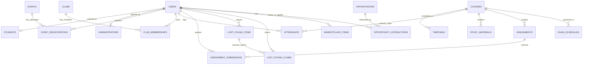

# Campus 360 — Relational SQL Database Architecture

This directory houses the comprehensive relational SQL database schema, DDL statements, seed records, and entity relationship diagrams for **Campus 360**.

---

## 🏗️ Database Architecture Overview

The database is designed according to **3rd Normal Form (3NF)** with strict foreign-key integrity constraints, unique indexes, and cascade deletion rules.



---

## 📋 Comprehensive Table Catalog (26 Relational Tables)

| # | Table Name | Purpose | Primary Key | Foreign Keys |
|---|---|---|---|---|
| 1 | `users` | Base credentials, avatars, and role specification (`student` / `admin`) | `id` | - |
| 2 | `students` | Student academic metadata: roll number, department, semester, CGPA | `id` | `users(id)` |
| 3 | `administrators` | Admin designations and faculty departmental governance | `id` | `users(id)` |
| 4 | `courses` | Course catalog (DSA, OS, DBMS, Networks, AI/ML) | `code` | - |
| 5 | `timetable` | Day-wise lecture slots, room allocations, class types | `id` | `courses(code)` |
| 6 | `attendance` | Course attendance logs, percentages, and debarment warnings | `id` | `users(id)`, `courses(code)` |
| 7 | `study_materials` | Digital slide decks, lecture PDFs, and laboratory sheets | `id` | `courses(code)` |
| 8 | `assignments` | Coursework problem statements, deadlines, and maximum marks | `id` | `courses(code)` |
| 9 | `assignment_submissions` | Student submissions (GitHub/Colab URLs), grading and marks | `id` | `assignments(id)`, `users(id)` |
| 10 | `exam_schedules` | Mid-semester exam timetable, halls, and seating allocation | `id` | `courses(code)` |
| 11 | `notices` | Campus-wide circulars, urgent announcements, and pinned bulletins | `id` | - |
| 12 | `events` | College fests (Technova), hackathons (HackSpark), sports tournaments | `id` | - |
| 13 | `event_registrations` | Student registration passes and unique barcode ticket IDs | `id` | `events(id)`, `users(id)` |
| 14 | `clubs` | Technical societies, arts dramatics, and sports committees | `id` | - |
| 15 | `club_memberships` | Student active memberships in collegiate societies | `id` | `clubs(id)`, `users(id)` |
| 16 | `lost_found_items` | Registry of reported lost or found items on campus | `id` | `users(id)` |
| 17 | `lost_found_claims` | Student ownership claims with verifiable proof descriptions | `id` | `lost_found_items(id)`, `users(id)` |
| 18 | `opportunities` | Curated internships (GSoC, DRDO), scholarships, and hackathons | `id` | - |
| 19 | `opportunity_interactions` | Student bookmarked and applied opportunities | `id` | `opportunities(id)`, `users(id)` |
| 20 | `marketplace_items` | Peer-to-peer textbook, calculator, and lab gear exchange | `id` | `users(id)` |
| 21 | `campus_locations` | Comprehensive directory of campus blocks, labs, and amenities | `id` | - |
| 22 | `transport_routes` | College bus routes, pickup points, timings, and vehicle numbers | `id` | - |
| 23 | `canteen_menu` | Daily food court items, prices, dietary tags (Veg), and status | `id` | - |
| 24 | `emergency_contacts` | 24/7 campus ambulance, security desk, and counselor hotlines | `id` | - |
| 25 | `feedback_grievances` | Student issue tracking with unique ticket IDs (`ISSUE-2026-xxx`) | `id` | - |
| 26 | `notifications` | Live push notifications and portal alerts | `id` | - |

---

## 🚀 How the Database is Used

### 1. Built-in SQLite (Zero Setup Required)
The project runs on **Node.js native SQLite (`node:sqlite`)** storing data in:
`backend/src/db/campus360.db`
- Requires **zero external database installations** or services.
- Executes real, standard SQL queries (`SELECT`, `INSERT`, `UPDATE`, `DELETE`, `JOIN`).
- Schema and seeds are automatically verified and seeded on first server start!

### 2. Exporting to MySQL / MariaDB (e.g., XAMPP, phpMyAdmin, MySQL Workbench)
If your university evaluator asks for a MySQL database:
1. Open MySQL Workbench or phpMyAdmin (`http://localhost/phpmyadmin`).
2. Create a database:
   ```sql
   CREATE DATABASE campus360;
   USE campus360;
   ```
3. Import `database/schema.sql`.
4. Import `database/seed.sql`.

### 3. Exporting to PostgreSQL
Both `schema.sql` and `seed.sql` use ANSI SQL syntax compatible with PostgreSQL:
```bash
psql -U postgres -d campus360 -f database/schema.sql
psql -U postgres -d campus360 -f database/seed.sql
```
